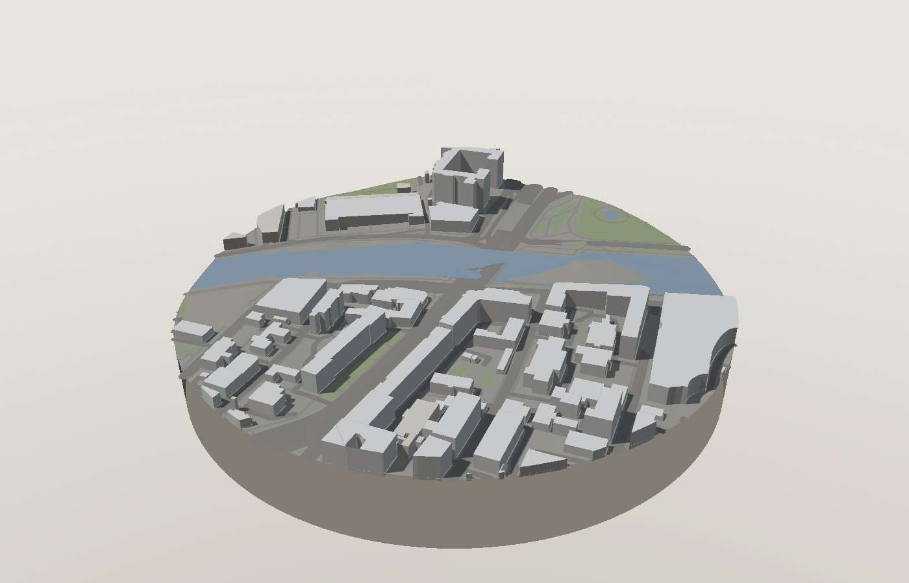
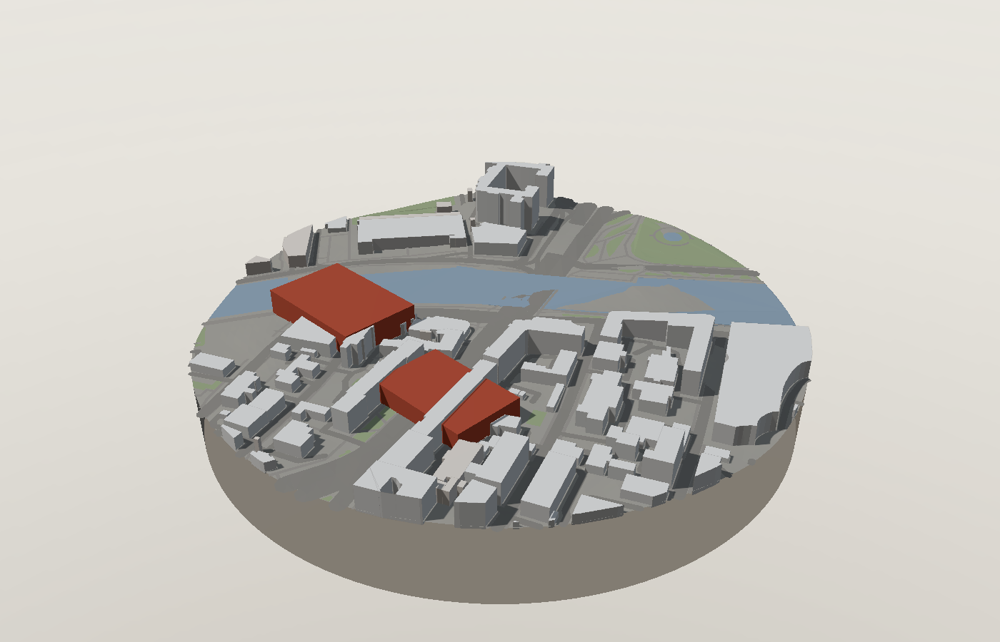
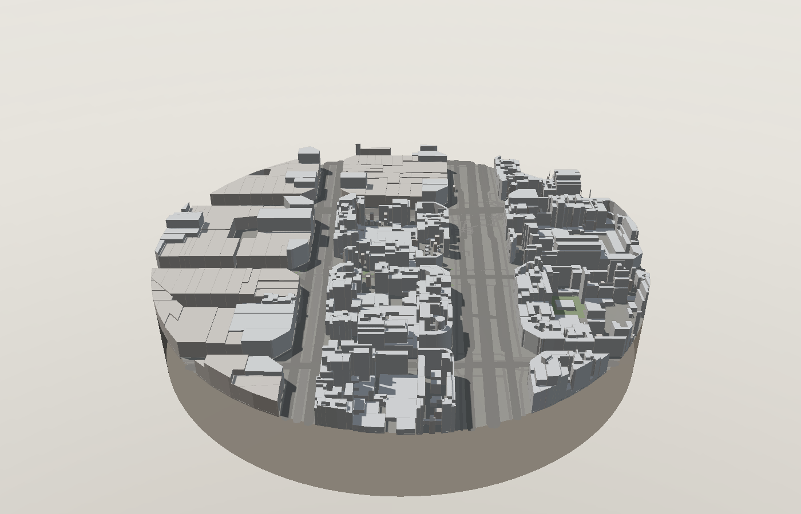

# Massing

**Pick a rectangle on the map of any city and get a 3D massing model of the site in your browser:** grey volumes, real sun position for any date, terrain, and density figures. An optional AI step turns the model into a photorealistic render, a short urban analysis, or new design volumes.

Everything runs locally. There is no server.



| Design volumes from a text brief | Barcelona |
|---|---|
|  |  |

## What it does

- **Builds the site from open data.** Buildings, roads, water and greenery from OpenStreetMap (Overpass API), terrain from AWS Terrain Tiles. The model is cut out as a cylindrical core, like a physical model on a stand.
- **Recovers missing heights.** Uses `height`, then `building:levels × 3.0 + 1.2`, then a typical value by building use. A toggle highlights estimated heights, so you can see how much of the model to trust.
- **Reads building age in Moscow.** 124,219 construction years from how-old-is-this.house set the morphotype: a 1950s Stalinist block gets 3.3 m floors and a cornice, a 1960s khrushchyovka 2.6 m and a flat roof.
- **Computes the sun.** Shadows and insolation for any date, time and time zone.
- **Reports density.** Floor area ratio, coverage, building heights and the share of estimated values.
- **Exports** PNG, OBJ and GeoJSON (open the design volumes in QGIS).
- **Optional AI** with your own key (Anthropic, Google Gemini, OpenAI or fal.ai): a photorealistic render that keeps the geometry and shadows, a written site analysis, or design volumes from a brief like "8-storey perimeter block along the embankment".

## Run

```bash
./serve.sh          # opens http://localhost:8765
```

It needs an http origin (ES modules, a web worker and Overpass requests), so `file://` will not work. A macOS desktop build is available through Electron: `npm install && npm start`.

## Stack

JavaScript (ES modules), three.js, Leaflet, Web Workers, IndexedDB cache, Electron. No build step.

## Limitations

- The model is only as good as OpenStreetMap coverage. Roof shapes are not modelled.
- Open DEMs are about 30 m resolution: retaining walls and terraces do not show up.
- Density is computed over the whole circle, streets and water included, not over a land plot.

Full documentation in Russian: [README.ru.md](README.ru.md).

## Data and licences

- © OpenStreetMap contributors, ODbL
- Building age: © how-old-is-this.house, 2020, ODbL
- Terrain: AWS Terrain Tiles (Mapzen terrarium), open data
- Geocoding: Nominatim

Code: MIT © Dmitrii Manuilov
